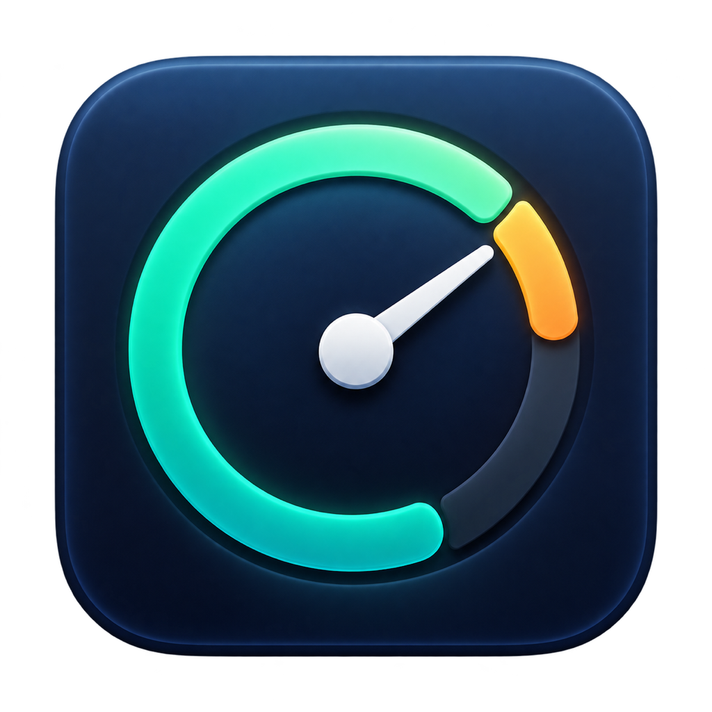

<p align="center">
  
</p>

<h1 align="center">ChatGPT 额度助手</h1>

<p align="center">在 macOS 菜单栏查看 Work / Codex 剩余额度与重置时间。</p>

<p align="center">macOS 14+ · Swift 6+ · 无第三方依赖 · MIT</p>

ChatGPT 运行时，菜单栏显示 `GPT 61%`；点击可查看各额度窗口及重置倒计时。退出 ChatGPT 后，菜单栏项目自动隐藏，助手在后台等待下次启动。

> 显示的是 Work / Codex 的额度窗口，不是普通聊天的消息计数，也不是 API 余额。根据 [OpenAI 官方说明](https://learn.chatgpt.com/docs/pricing)，ChatGPT Work 与 Codex 共用额度；实际可用窗口以账号服务返回的数据为准。

## 功能

- 显示服务返回的多个额度窗口，包括窗口时长、剩余百分比和重置时间。
- 菜单栏显示所有有效窗口中最低的剩余百分比。
- 每 60 秒刷新；打开面板、切回 ChatGPT、唤醒电脑及收到额度通知时也会请求更新。
- 支持登录 macOS 时启动，无 Dock 图标。
- 读取失败时清空旧数字；数据超过两分钟未更新时标记过期。

## 使用条件

- macOS 14 或更新版本。
- 已安装并登录带有内置 Codex App Server 的 ChatGPT 桌面端；仅安装普通聊天版不一定满足条件。
- 账号服务能够返回可用的额度窗口；只使用 API Key 的场景不在本项目支持范围内。
- 读取额度时需要网络连接。

目前验证环境为 Apple Silicon，详见 [验证记录](VALIDATION.md)。Intel 与其他桌面端版本的兼容性尚未完成验证。

## 安装与启动

### 从源码构建

安装 Swift 6.0+ 和匹配的 macOS SDK（Xcode 或 Xcode Command Line Tools）。在项目根目录执行：

```sh
./scripts/test.sh
./scripts/build.sh
```

构建结果为 `dist/ChatGPT额度助手.app`。

### 使用应用

1. 将构建得到的 `ChatGPT额度助手.app` 拖到“应用程序”文件夹。
2. 打开 ChatGPT 并登录账号，再双击额度助手。
3. 点击菜单栏的 `GPT …` 查看各窗口的额度。
4. 如需随系统启动，勾选面板中的“登录 macOS 时启动”。

仓库若提供 Release 安装包，请按对应版本的说明下载和安装。默认构建采用本地 ad-hoc 签名，**未经 Apple 公证**；从互联网下载后可能被 macOS 拦截。确认来源后，可按 [Apple 的应用打开说明](https://support.apple.com/zh-cn/102445) 处理，或自行从源码构建。

## 显示规则

| 项目 | 行为 |
| --- | --- |
| 剩余百分比 | `100 − usedPercent`，限制在 0–100；界面四舍五入为整数 |
| 菜单栏数字 | 所有有效窗口的最低剩余值 |
| 窗口名称 | 根据服务返回的实际时长生成，不固定假设主窗口是 5 小时 |
| 缺少字段 | 缺少有效用量的窗口不显示；时长或重置时间缺失时标记未知 |
| 数据过期 | 超过两分钟未更新后，菜单栏显示 `GPT —`，面板提示过期 |
| 重置时间已到 | 等待服务重新确认，不自行把额度改为 100% |

服务端统计延迟、其他客户端的使用和网络状况都会影响更新时效。面板中的倒计时随界面更新，不是逐秒计时器。

## 隐私与工作方式

助手启动 ChatGPT 自带的 `codex app-server --stdio`，通过本地 JSON-RPC 通信，只发送 `initialize`、`initialized` 和 `account/rateLimits/read`。协议见 [官方 App Server 文档](https://learn.chatgpt.com/docs/app-server)。

助手本身不读取或复制登录令牌，不读取聊天内容，不创建聊天或运行模型任务；没有遥测与自建服务器。内置服务负责身份认证、凭证更新及与 OpenAI 服务通信，也可能维护自己的本地运行数据。

图标为独立设计的额度仪表图案。本项目与 OpenAI 无隶属或官方合作关系。

## 常见问题

**打开后没有图标？** 助手仅在检测到 ChatGPT 运行时显示菜单栏项目。它没有 Dock 图标；隐藏期间可通过“活动监视器”找到 `QuotaCompanion` 并退出。

**提示找不到内置服务？** 更新 ChatGPT 桌面端，并确认所用版本带有 Codex 服务。当前适配的二进制位置见 [开发说明](CONTRIBUTING.md)，应用升级后路径可能变化。

**提示登录或读取失败？** 在 ChatGPT / Codex 中确认账号登录状态，检查网络，再点击“刷新”。读取失败时不会继续展示旧额度。

**无法设置开机启动？** 先将 app 放入“应用程序”文件夹，再设置；必要时在“系统设置 → 通用 → 登录项”中允许启动。

## 开发与发布

- [开发、测试与图标资源](CONTRIBUTING.md)
- [GitHub 上传清单与发布步骤](docs/RELEASING.md)
- [验证结果与待验证事项](VALIDATION.md)

## 参考项目

[CodexBar](https://github.com/steipete/CodexBar) 是成熟的 macOS 菜单栏额度工具，采用 MIT 许可。本项目参考其公开的 [Codex 数据源方案](https://github.com/steipete/CodexBar/blob/main/docs/codex.md)，围绕单一额度显示需求独立实现，未引入其代码或依赖。

## 许可证

[MIT License](LICENSE)。ChatGPT、Codex 等名称和相关商标归其各自权利人所有。
